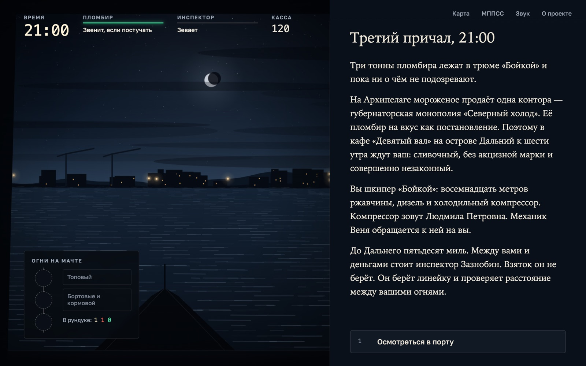
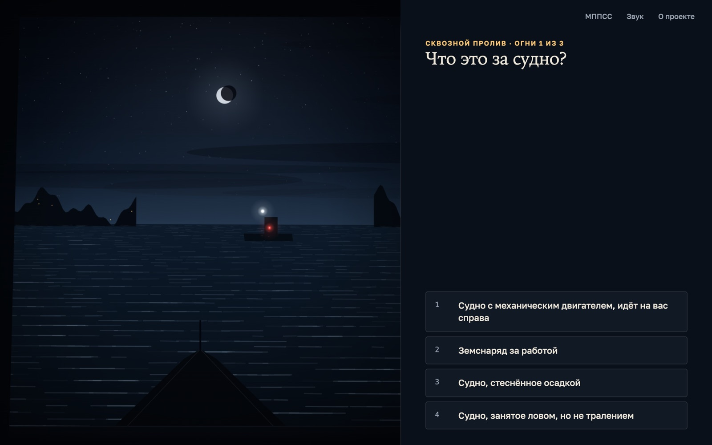
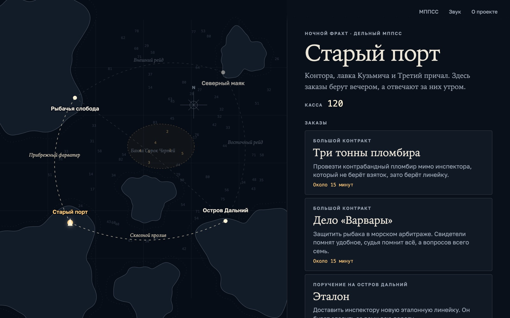
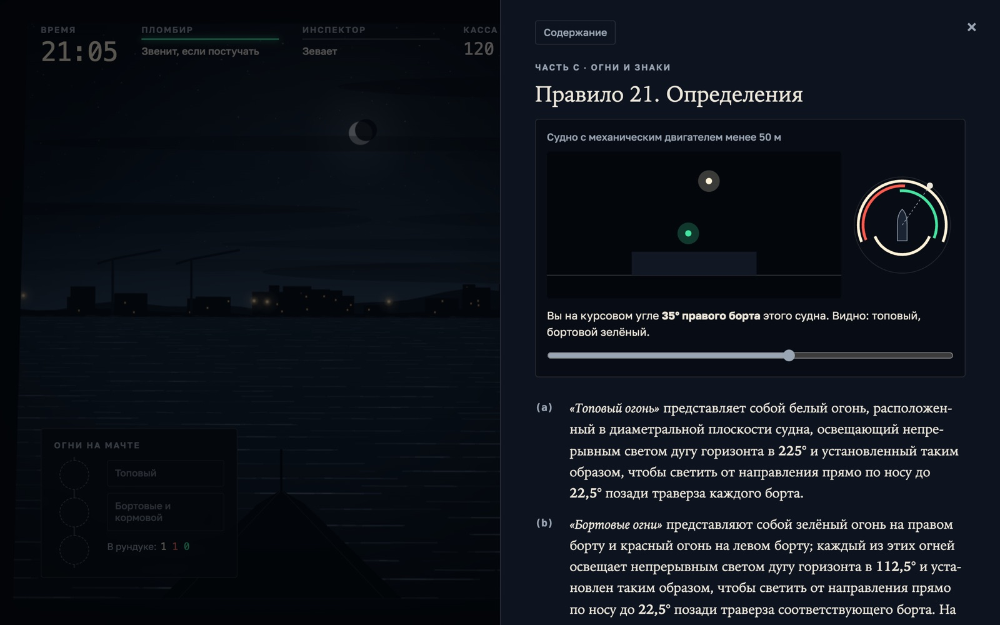

# Night Freight · Дельный МППСС

**A browser game that teaches the Collision Regulations by making you use them.**

[**Play at colreg.deelstuff.com →**](https://colreg.deelstuff.com/)



You are the skipper of the *Boikaya*: eighteen metres of rust, a diesel and a refrigerating compressor
that the engineer addresses by name and patronymic. The Archipelago has four ports, one honest
inspector and plenty of cargo that would rather travel at night. Inspector Zaznobin takes no bribes. He
takes a ruler and measures the distance between your lights.

Night Freight is a set of text quests in the spirit of *Space Rangers 2*, joined by a chart of ports. The
COLREGs (the International Regulations for Preventing Collisions at Sea, МППСС in Russian) are not exam
questions here. They are the skipper's tools. A smuggler who wants to look innocent has to show exactly
the right lights. A lawyer in a maritime arbitration wins only with the rules that are already proven. When
you get it wrong, the antagonist explains why, rule and paragraph included, at the moment it hurts most.

The game is in Russian. It runs in any modern browser, on desktop and on a phone, with no sign-up.

## What is in the game

| | |
|---|---|
|  |  |
| **Passages.** Between ports you see only the lights of the vessels you meet. A wrong answer costs money, and the rules you have missed before come up more often. | **The chart.** Four ports and five passages. Each port has its own jobs, and the boat stays where it docked. |



- **Contracts**, about 15 minutes each. *Three Tonnes of Ice Cream* runs contraband past the inspector
  through a night of tows, fishing boats, dredgers and a sunrise that wants day shapes. *The Varvara Case*
  defends a fisherman in maritime arbitration with seven questions for the whole case.
- **Errands**, 3–5 minutes. Five set-ups (a concert piano, live crayfish, a midwife, coffee and a
  reference ruler), each dealt a fresh hand of encounters from the deck of that passage.
- **The boat and the world remember.** Fittings bought in one port stay aboard for every voyage. The
  inspector, the ports and Marfa remember what you did on earlier runs.
- **A watchkeeper.** Hire one of three characters in port. Each comments on the encounters and is right
  about some lights and wrong about others.
- **The rule book.** All 41 rules and four annexes, searchable and typeset, with cross-references
  and the defined terms linked to Rule 3. Interactive figures sit beside the text: a vessel's lights
  as you walk around it, situations by bearing, sound signals you can play, day shapes and distress
  signals. Opening a rule during a voyage costs five minutes of the night.

## Design

- **A rule is a lockpick.** The honest answer and the clever one are not opposites, so you cannot guess
  your way through by picking the most virtuous wording.
- **Colour belongs to lights only.** The night screen is almost black, and every saturated spot means
  something. Lights are computed from the vessel type and the angle of view, using the Rule 21 sectors.
- **Every choice is measured.** Quests are written in a small quest language and checked by an exact
  solver. It answers whether the quest can be won, how often random play wins, and whether knowing a
  rule changes the outcome.

## How it is built

A static site with no server, no accounts and no npm dependencies: ES modules, Canvas 2D for the sea
and the chart, Web Audio for the sound. Progress stays in the player's own browser.

| Path | What it holds |
|---|---|
| `index.html`, `src/freight.js` | The page and the wiring: quest screen, mast, review, rule book |
| `src/freight-world.js`, `src/freight-port.js` | Ports, passages, offers, fittings, watchkeepers, world memory; the port panel |
| `src/freight-book.js`, `-figures.js`, `-signals.js` | The rule book, its figures and its playable signals |
| `src/freight-sea.js`, `-chart.js`, `-audio.js`, `-practice.js` | The wheelhouse view, the chart, sound, the lights on passages |
| `src/quest-vm.js`, `src/quest-assemble.js` | The quest machine and the assembly of errands from parts |
| `src/rules-text.js` | The local COLREG text with its recorded editorial fixes |
| `quests/freight/` | Quest sources: contracts, the encounter deck, errands and their template |
| `tools/questlab/` | Quest Lab: compiler, solver, prose linter and the `ql` command line |
| `tests/` | `node:test` suites, module boundaries included |

The game's design notes are in [docs/FREIGHT.md](docs/FREIGHT.md), and Quest Lab is described in
[tools/questlab/README.md](tools/questlab/README.md). Both are in Russian.

## Running it locally

Python 3 serves the game, and Node.js 24 runs the tests and the build.

```sh
npm run dev      # http://127.0.0.1:4183
npm test
npm run gates    # every quest through the solver, with the quality thresholds
npm run build    # the static site in dist/
```

Without `node` on the PATH, `tools/questlab/ql` finds a Node 24 itself: `ql test`, `ql gates`, `ql site`.
A push to `main` runs the tests and the gates and publishes the site to GitHub Pages.

## Sources

The rule text comes from the Russian edition published by ForceSail and is checked against the
international text of the IMO and the USCG Navigation Rules Handbook. Every place where the game's text
differs from the source is listed in [docs/SOURCES.md](docs/SOURCES.md) with the reason.

The game is a learning model, sped up and simplified. Its times and distances are not safe values for
real navigation.

## Legal

Impressum, Datenschutz and the sources open inside the game, from «О проекте» on every screen.

The code is proprietary, and all rights are reserved by the author. Third-party texts and the Golos Text
font keep their own terms; see [docs/SOURCES.md](docs/SOURCES.md) and [assets/fonts/](assets/fonts/).
